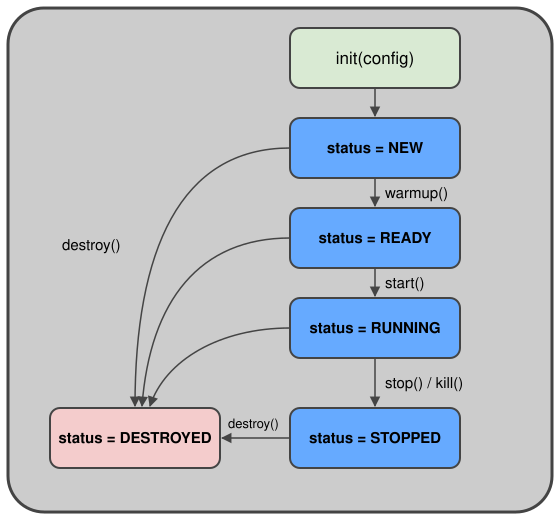

.. _explain_pipelines:

Pipelines
=========

Pipelines act as graph managers and lifecycle coordinators. A pipeline object
knows when to start nodes, how to connect them, and where to store their state.
It transforms a declarative configuration into a running, observable dataflow
system.

At its core, a Pipeline is a configuration interpreter. Strictly speaking, it
doesn't contain business logic, so its only responsibility is to instantiate
nodes, wire them together according to the graph definition, and manage their
collective lifecycle. This separation of concerns is deliberate: the pipeline
handles topology, while nodes handle data processing and transformation.

The easiest way to interact with Juturna pipelines is through ``JSON`` objects.
The definition of a pipeline graph can be included in a plain ``JSON`` file, and
the library will *compile* it into a pipeline instance. When defining a
pipeline, however, we still need to provide Juturna with a few extra bits of
information.

Configuration
-------------

A pipeline configuration looks something like this:

.. code-block:: json

    {
      "version": "3.0.0",
      "pipeline": {
        "name": "my_awesome_pipeline",
        "id": "1234567890",
        "folder": "./running_pipelines",
        "nodes": [ ],
        "links": [ ]
      }
    }

``name`` and ``id`` identify the pipeline: the name is used for logging, the
id by tools that manage several pipelines at once. ``folder`` is where the
pipeline keeps its files: a copy of the configuration, and one folder for each
node, where the node can store data and artifacts. ``nodes`` and ``links``
describe the graph. Every key is described in
:ref:`reference_configuration`.

Once we have this configuration in place, we can create the pipeline object.

.. code-block:: python

    import juturna as jt

    pipe = jt.components.Pipeline.from_json('path/to/config.json')

The ``Pipeline`` class constructor also accepts dictionary objects:

.. code-block:: python

    import json

    import juturna as jt

    with open('path/to/config.json') as f:
        config = json.load(f)

    pipe = jt.components.Pipeline(config)

Pipeline lifecycle
------------------

Instantiating a pipeline object doesn't really do much. An empty pipeline
container is created, with all the instructions required to build the actual
nodes and linking them.

A pipeline object is always in one of five states:

- a ``NEW`` pipeline is freshly created, but the nodes within the graph still
  need to be instantiated;
- a ``READY`` pipeline instantiated all the concrete nodes, and acquired
  system and external resources required for its functioning - as the state
  name says, this pipeline is ready to go;
- a ``RUNNING`` pipeline is consuming data sources, processing and sending them,
  so it is working (hopefully) just how it is supposed to;
- a ``STOPPED`` pipeline was running, and is not anymore. It cannot be started
  again;
- a ``DESTROYED`` pipeline released everything it held, and is of no further
  use.

These methods move a pipeline through its lifecycle:

``warmup()`` triggers node instantiation and linking, moving a pipeline from
``NEW`` to ``READY``. Internally, this calls the warm up method on every node in
the pipeline. Depending on the resources nodes need to acquire (learning
models, third-party services, network connections), calling the ``warmup`` can
be time-consuming.

``start()`` triggers the beginning of the pipeline workflow, moving its state
from ``READY`` to ``RUNNING``. Internally, this calls the start method on every
node in the pipeline.

``stop()`` interrupts the pipeline execution, moving it from ``RUNNING`` to
``STOPPED``. Nodes are stopped from the sources down, and each one processes
the messages it already received before stopping, so nothing is lost.

``destroy()`` releases the nodes and their resources, moving the pipeline to
``DESTROYED``. It can be called in any state; a running pipeline is stopped
first.

``kill()`` stops a running pipeline without processing the messages still in
the queues of its nodes, and without waiting for a node that is busy: every
node thread gets ``JUTURNA_THREAD_JOIN_TIMEOUT`` seconds to exit, then it is
left behind.

Stopping when something goes wrong
~~~~~~~~~~~~~~~~~~~~~~~~~~~~~~~~~~

``stop()`` waits for every ``update()`` call in progress, however long it
takes. When a node does not come back, call ``kill()`` from another thread:
it is the only lifecycle method allowed while a ``stop()`` is in progress
(every other one raises ``PipelineBusyError``). The kill reaches every node,
the stop in progress no longer waits and discards the pending messages, and
``kill()`` returns once that stop is over. The same holds for the stop that
``destroy()`` runs on a running pipeline.

.. code-block:: python

   stopper = threading.Thread(target=pipeline.stop)
   stopper.start()
   stopper.join(timeout=30)

   if stopper.is_alive():
       pipeline.kill()

``stop()``, ``kill()`` and ``destroy()`` always go through all the nodes. When
the ``stop()`` or the ``destroy()`` of a node raises, the error is logged, the
threads of that node are stopped all the same, and the other nodes follow. The
pipeline reaches ``STOPPED`` (or ``DESTROYED``), and only then the first error
is raised to the caller: a pipeline with a node that fails to clean up can
still be destroyed.

An interrupt (``ctrl+c``) during ``stop()`` or ``destroy()`` leaves the
pipeline free for another call, which goes on with the nodes that are left.

A node that stops on its own does not hold the others: the messages sent to a
stopped node are discarded, so the nodes before it never wait for it.

``update_node()`` changes a property of a node from the thread of the caller.
It raises ``PipelineNotReadyError`` before the warm up and
``PipelineDestroyedError`` after the destruction.

A call that does not respect these transitions raises an exception that says
why, such as ``PipelineNotReadyError`` for a ``start()`` before the warm up or
``PipelineStoppedError`` for a ``start()`` after a stop. They all derive from
``PipelineStateError``, which is a ``RuntimeError``. Calling a method on a
pipeline that is already where the method leads (``stop()`` on a stopped
pipeline) does nothing.

If a node fails during ``warmup()`` or ``start()``, the pipeline undoes what
it did and goes back to the state it was in, so the call can be tried again.

.. admonition:: Warming up and configuring
    :class: :NOTE:

    A node defines 2 separate methods to get up and running: ``warmup`` and
    ``configure``. Ideally, you want to use the ``configure`` method to acquire
    resources that need to be acquired externally, so depend not only on the
    node implementation (ports, connections), and the ``warmup`` to prepare the
    node internal status for execution.

.. admonition:: A stopped pipeline stays stopped
    :class: :ATTENTION:

    **Pipelines cannot be restarted once stopped, only destroyed.** If you
    need to stop a pipeline and later run it again, destroy it and create a
    new one from the same configuration.
