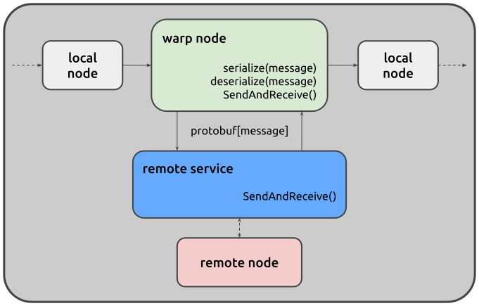

.. _explain_remote:

Remote components
=================

When creating a juturna pipeline, all its components are instantiated locally.
Whilst this is ideal when developing new nodes and checking that everything
works fine on your own machine or container, in many production scenarios having
the ability to leverage remote resources, such as GPUs, is not a plus but a
must. For this reason, juturna offers the basic infrastructure to deploy nodes
remotely, while still using them as if they were local entities. We call this
**warping**.

Warping a node enables the remote execution of that node, included in a local
pipe. You can deploy specific nodes as remote services that communicate with the
main pipe over the network using gRPC and Protocol Buffers (Google's
`protobuf <https://github.com/protocolbuffers/protobuf>`_).

This architecture allows a local pipe to offload processing to remote node
handlers, which manage the node lifecycle and act as message brokers for
incoming and outgoing queues.

The warping mechanism addresses common topics in several deployment scenarios.
To name a few, remote nodes are deployed with dependency isolation, so they do
not clash with conflicting dependencies from other nodes in the same pipeline.
Also, sharing and scaling are strong suits of remote nodes, as they can serve
multiple pipelines simultaneously, or be made redundant and masked by a load
balancer.

.. admonition:: Remotisation features might be unstable (|version|-|release|)
    :class: :WARNING:

    The infrastructure to deploy juturna nodes remotely is still under
    active development. We do not recommend using it in production scenarios, or
    for mission-critical components.

Warping fundamentals
--------------------

When a node is configured for remote execution, two components work together. On
the local side (that is, the `main` juturna process) a node intended for remote
deployment is masked by a **warp node**. A warp node is a simple processing node
acting as local client or proxy for the remote node. Warp nodes are responsible
for managing the communication with the remote service behind which the concrete
node lives. This means, they receive messages from the pipeline normally, turn
them into protocol buffers, send them over the remote service, and then unpack
the responses they receive.

On the remote side runs the **remote service**, a standalone gRPC server that
holds the concrete node doing the actual computation work, acting as a
publish/subscribe broker for its input and output queues. Similarly to the warp
node, the remote service manages the marshalling and unmarshalling of the data
received from the local pipe.

State and replicas
------------------

The concrete node keeps its state between messages, like a local one. Each warp
node gets its own state on the remote side, even when one remote service serves
several pipelines, and the ``sticky`` flag of the warped node tells where that
state lives:

- **sticky** (the default): the remote service keeps the state of each warp
  node, and sends a copy back with every response. The warp node must always
  reach the same service. It sends its copy only when the service answers that
  it does not know it, after a restart or once an idle state was dropped, and
  the service starts again from that copy.
- **not sticky**: the remote service keeps nothing. The warp node sends its
  state with every request, the remote node updates it, and the response brings
  it back. Any replica behind a load balancer can serve any request, and a
  replica going down loses no state. The state travels on every request, so
  keep it small.

In both cases the remote service answers when ``update()`` returns. A message
that the node keeps in its state without transmitting anything gets an empty
response at once, and the warp node transmits nothing downstream.

What cannot reach the client
----------------------------

Messages and states keep their exact types on the wire: ``None``, booleans,
ints, floats, strings, bytes, lists, tuples, frozensets, dictionaries, numpy
arrays and scalars, and messages. Some things still cannot reach the warp node:

- a value of another type (a set, an open file, a model) in the ``meta`` of a
  message, in an ``ObjectPayload`` or in the state;
- a second message transmitted by the same ``update()``: only the first one is
  sent back;
- a message transmitted after ``update()`` returned, for example by a thread of
  the node: its request was already answered.

By default the remote service leaves them out and logs a warning, once for
each client and for each kind of loss: a dictionary loses the entry, a list or
a tuple the item, and everything else is sent. A state that loses an entry
loses it for good, in the copy kept by a sticky warp node as well, so keep
such objects in the node rather than in its state. The warp node does the same
with the messages it sends.

Started with ``--strict``, the remote service fails the request with the
``DATA_LOSS`` gRPC status instead, every time. A message transmitted late fails
the next request of its warp node, which is not processed. The warp node
counts the failure in its health, and the pipeline goes on with the next
message.

Developer notes
---------------

Juturna installation includes pre-compiled protobuf classes, ready to use out of
the box. However, if you need to modify the .proto definitions or recompile them
for development purposes, two utility scripts are provided:

- ``juturna/remotizer/compile_protos.sh``: Recompiles the .proto files into
  Python classes
- ``juturna/remotizer/expose_protos.sh``: Exports the compiled protobuf classes
  for external use. This requires to install the additional ``protoletariat``
  dependency.

These scripts should only be needed when modifying the protocol definitions or
contributing to the Warp node implementation.
