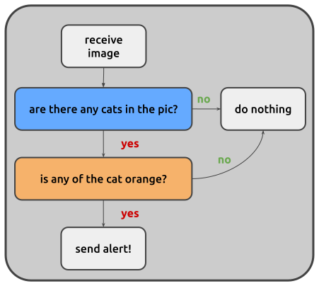

Write and package a node
========================

This guide shows how to write a custom node and make it available to your
pipelines. As an example we build ``RedCatDetector``, a processing node that
uses a YOLO model to detect red cats in the images it receives.

If you have never written a node, the :ref:`tutorial <tutorial>` is a gentler
start.

Where nodes live
----------------

Juturna finds nodes in installed Python packages, under three namespaces:

- ``juturna.nodes``, for the official ``juturna-nodes`` package;
- ``juturna.extensions``, for extension packages;
- ``juturna.contrib.<package>.nodes``, for everybody else. This is where
  your nodes go, with ``<package>`` being your name or the name of your
  organisation.

A node repository has this layout:

.. code-block:: text

    my-nodes/
    ├── pyproject.toml
    └── src/juturna/contrib/<package>/
        ├── __init__.py
        └── nodes/
            ├── __init__.py
            └── _<node_name>/
                ├── <node_name>.py
                ├── config.toml
                ├── requirements.txt
                └── README.md

``juturna`` and ``juturna/contrib`` are namespaces shared by every node
package installed, so they must **not** have an ``__init__.py`` file.

Create the skeleton
-------------------

From the root of the repository, let the ``stub`` command create the files:

.. code-block:: console

    (.venv) $ python -m juturna stub \
                     --node-name red_cat_detector \
                     --package catwatch \
                     --author "Cat Watcher" \
                     --email watch@cat.com
    Node creation successful! Node type: contrib.catwatch.nodes.RedCatDetector

The command writes the node folder in
``src/juturna/contrib/catwatch/nodes/_red_cat_detector/`` and registers the
class in ``nodes/__init__.py``:

.. code-block:: python

    _AVAILABLE_PLUGINS: dict[str, str] = {
        'RedCatDetector': '._red_cat_detector.red_cat_detector',
    }

The node type it prints is what goes in the ``type`` field of a pipeline
configuration.

If you create the files by hand:

- the node folder name starts with an underscore
  (``_red_cat_detector``);
- the module has the name of the folder, without the underscore
  (``red_cat_detector.py``);
- the class must be added to ``_AVAILABLE_PLUGINS``, or Juturna will not
  find it.

Declare the arguments
---------------------

The arguments a node accepts, with their default values, are declared in its
``config.toml``. Our detector needs to know which model to use, where to run
it, and two thresholds:

.. code-block:: toml

    [arguments]
    model = "yolo11x.pt"
    device = "cuda"
    cat_min_confidence = 0.4
    orangeness_threshold = 0.6

    [meta]

A pipeline configuration can override any of them. Keys that are not declared
here are dropped (``juturna validate`` warns about them), so every argument
needs a default.

Add dependencies
----------------

The node uses `YOLO <https://docs.ultralytics.com/>`_ and OpenCV. List them in
the dependencies of your package (see `Package the nodes`_), and install them
in your environment:

.. code-block:: console

    (.venv) $ pip install ultralytics opencv-python

Juturna does not install the dependencies of a node for you: they come with
the package the node is in.

Implement the node
------------------

The arguments of ``config.toml`` reach the node as arguments of ``__init__``.
Everything else (the node name, the pipeline name) travels in ``kwargs`` and
goes to the base class.

.. code-block:: python

    import typing

    import cv2
    import numpy as np

    from ultralytics import YOLO

    from juturna.components import Message
    from juturna.components import Node
    from juturna.payloads import ImagePayload

    class RedCatDetector(Node[ImagePayload, ImagePayload]):
        def __init__(
            self,
            model: str,
            device: str,
            cat_min_confidence: float,
            orangeness_threshold: float,
            **kwargs,
        ):
            super().__init__(**kwargs)

            self.model_name = model
            self.device = device
            self.cat_min_confidence = cat_min_confidence
            self.orangeness_threshold = orangeness_threshold

            self.model = None
            self._target_class = list()

The two type parameters of ``Node`` are the payload the node receives and the
one it transmits: here images in, annotated images out.

Loading the model takes time and memory, so it belongs in ``warmup()``, which
the pipeline calls once before starting:

.. code-block:: python

    def warmup(self):
        self.model = YOLO(self.model_name)
        self.model.to(self.device)

        # we only care about cats
        self._target_class = [
            k for k, v in self.model.names.items() if v == 'cat'
        ]

        self.logger.info('model ready')

The work happens in ``update()``, called once for every message received:

- run the image through the model;
- keep the cats that are orange enough;
- transmit an annotated image when at least one is found.

.. code-block:: python

    def update(self, message: Message[ImagePayload], **kwargs):
        image = message.payload.image

        results = self.model.predict(
            image,
            verbose=False,
            conf=self.cat_min_confidence,
            classes=self._target_class,
        )

        orange_cats = list()

        for idx, box in enumerate(results[0].boxes):
            x1, y1, x2, y2 = map(int, box.xyxy[0])

            if self._is_cat_orange(image[y1:y2, x1:x2]):
                orange_cats.append(idx)

        # no cat, or none of them orange enough: nothing to send
        if not orange_cats:
            return

        results[0].boxes = results[0].boxes[orange_cats]
        annotated = results[0].plot()

        to_send = Message[ImagePayload](
            creator=self.name,
            version=message.version,
            payload=ImagePayload(
                image=annotated,
                width=annotated.shape[1],
                height=annotated.shape[0],
                depth=annotated.shape[2],
                pixel_format=message.payload.pixel_format,
                timestamp=message.payload.timestamp,
            ),
            timers_from=message,
        )

        to_send.meta['orange_cats'] = len(orange_cats)

        self.transmit(to_send)

    def _is_cat_orange(self, crop_rgb: np.ndarray) -> bool:
        hsv = cv2.cvtColor(crop_rgb, cv2.COLOR_RGB2HSV)
        mask = cv2.inRange(
            hsv, np.array([5, 50, 50]), np.array([25, 255, 255])
        )

        return np.count_nonzero(mask) / mask.size > self.orangeness_threshold

A few rules worth remembering:

- ``update()`` always takes ``**kwargs``: the pipeline passes the node state
  in ``kwargs['state']`` (see `Keep data between messages`_);
- a received message is frozen. To send it on with changes use
  ``message.copy()``, to send new data build a new ``Message``
  (see :ref:`explain_messages`);
- only ``Message`` objects can be transmitted;
- an exception raised by ``update()`` is logged and counted in the node
  health, and the node goes on with the next message.

The orangeness check is rough (it may fail if you, just like me, have an
orange wall), but for now we'll make do.

Keep data between messages
--------------------------

A node that needs to remember something from one message to the next uses its
state, a dictionary the pipeline keeps for it:

.. code-block:: python

    def update(self, message: Message[ImagePayload], **kwargs):
        state = kwargs['state']
        state['seen'] = state.get('seen', 0) + 1

The same goes for a node with several inputs that needs a message from each
before producing its output: it keeps the pending ones in the state. See
:ref:`explain_nodes` for an example.

Write a source node
-------------------

A source node produces messages instead of receiving them. In ``__init__``
it registers a function with ``set_source()``:

.. code-block:: python

    def __init__(self, interval: float, **kwargs):
        super().__init__(**kwargs)

        self.set_source(self._read_frame, by=interval, mode='pre')

The function returns a ``Message``, or ``None`` when it has nothing to
deliver. With ``mode='pre'`` the node waits ``by`` seconds before each call,
with ``mode='post'`` (the default) after it. With ``by=0`` the function is
called again right away, so it should block until data is available.

The messages it returns arrive in ``update()``, which normally just transmits
them.

Change a node while it runs
---------------------------

To let a property change while the pipeline is running, implement
``set_on_config()``:

.. code-block:: python

    def set_on_config(self, prop: str, value: typing.Any):
        if prop == 'cat_min_confidence':
            self.cat_min_confidence = value
        elif prop == 'orangeness_threshold':
            self.orangeness_threshold = value
        else:
            self.logger.warning(f'cannot update property {prop}')

It is called through the pipeline:

.. code-block:: python

    pipeline.update_node('detector', 'cat_min_confidence', 0.7)

The call runs in the thread of the caller, possibly while ``update()`` is
working: if the two touch more than a simple value, protect it with a lock.

Package the nodes
-----------------

A node repository is a normal Python package. A minimal ``pyproject.toml``,
using ``hatchling``:

.. code-block:: toml

    [project]
    name = "catwatch-nodes"
    version = "0.1.0"
    requires-python = ">=3.12"
    dependencies = ["juturna>=3.0.0", "ultralytics", "opencv-python"]

    [build-system]
    requires = ["hatchling"]
    build-backend = "hatchling.build"

    [tool.hatch.build.targets.wheel]
    only-include = ["src/juturna/contrib/catwatch"]
    sources = ["src"]

Install it in the environment where your pipelines run:

.. code-block:: console

    (.venv) $ pip install .

While developing, ``export PYTHONPATH=src`` from the root of the repository
does the same job without installing anything.

Use the node
------------

In a pipeline configuration, the node is:

.. code-block:: json

    {
      "name": "detector",
      "type": "contrib.catwatch.nodes.RedCatDetector",
      "configuration": {
        "model": "./models/yolo11x.pt",
        "cat_min_confidence": 0.5
      }
    }

``device`` and ``orangeness_threshold`` keep the defaults of ``config.toml``.
